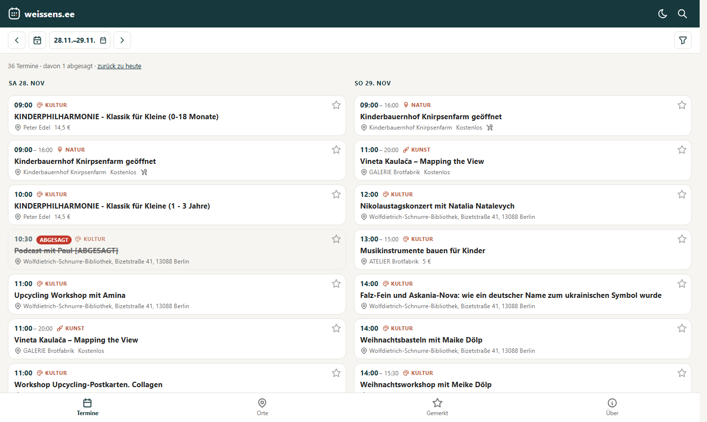

# openLitfass documentation

**openLitfass** is a lightweight, self-hosted events calendar: your own digital
advertising pillar (*Litfaßsäule*) for a neighbourhood, a village, a club or
event days with many talks and workshops. It collects events from the
feeds, calendars and websites you choose, adds events entered by hand, and
publishes everything as a **static website**: no database, no API server and
no tracking.



## Features

- **Automatic import** from RSS feeds, JSON APIs, iCalendar (`.ics`) exports,
  HTML pages and WordPress "Weekly Class Schedule" calendars, configured by
  field mapping in a JSON file per source. No code is needed for a new source.
- **Event inbox** for single events without a feed: one JSON file per event,
  including recurring opening hours with holidays and seasons.
- **Merging** of the same event from several sources, with a priority per
  source.
- **Fault tolerance:** a broken source never breaks the whole run. Its error
  and the time of its last success are written back to its own file.
- **Front end** without a framework: day, weekend and week views, filters by
  category and attribute, full-text search, saved events, `.ics` download,
  sharing, maps from OpenStreetMap on demand, light and dark mode, and an
  installable PWA that works offline.
- **Places:** an optional directory of venues, parks and sights, linked to
  their upcoming events.
- **Static pages and sitemap** for search engines and link previews
  (optional).
- **One container image** (`ghcr.io/schreibtischhelden/openlitfass`, amd64 and
  arm64) that fetches, builds and serves an instance, with `/healthz` and
  Prometheus metrics.

## How it fits together

openLitfass is split into the **core** and any number of **instances**:

```
openlitfass (core)                              your instance repository
  backend/  Go: fetch, build-site, serve        instance.json
  web/      front end (HTML/CSS/JS)             sources/  inbox/  categories.json
  Containerfile ──► ghcr.io image ────────────► runs against the instance
  example-instance/  template                   site/  (theme, logo)
                                                data/  (generated)
```

- The **core** ([schreibtischhelden/openlitfass](https://github.com/schreibtischhelden/openlitfass))
  contains all code and is published as a container image.
- An **instance** is a directory, usually a Git repository of its own, with
  configuration, sources, hand-made events and styling, but no code.
  [weissens.ee](https://weissens.ee) for Berlin-Weißensee
  ([repository](https://github.com/weissensee/weissens.ee)) is a real example.

The image runs against the instance directory: it fetches all sources, writes
the events to `data/` and builds a static site from the core front end, the
instance's styling and the data. Where that runs is up to you: as a
self-contained container on your own server, or as a scheduled GitHub Actions
workflow that publishes to GitHub Pages.

## Where to start

<div class="cards">
<a href="?page=setup"><strong>Setup</strong>Create an instance and run it with Docker or GitHub Actions.</a>
<a href="?page=sources"><strong>Sources</strong>Connect feeds, calendars and websites.</a>
<a href="?page=configuration"><strong>Configuration reference</strong>Every setting in <code>instance.json</code>, source files and <code>OL_</code> variables.</a>
<a href="?page=troubleshooting"><strong>Troubleshooting</strong>A source fails, nothing shows up, changes do not appear.</a>
</div>

## Getting help

- Questions, bugs and ideas about the software:
  [issues of the core repository](https://github.com/schreibtischhelden/openlitfass/issues).
- Security problems: please report them privately, see the
  [security policy](https://github.com/schreibtischhelden/openlitfass/security/policy).
- Mistakes in this documentation:
  [openlitfass-docs](https://github.com/schreibtischhelden/openlitfass-docs),
  or use "Edit this page on GitHub" at the bottom of every page.

openLitfass is released under the MIT Licence. The category and filter icons
come from [Tabler Icons](https://tabler.io/icons), also under the MIT Licence.
